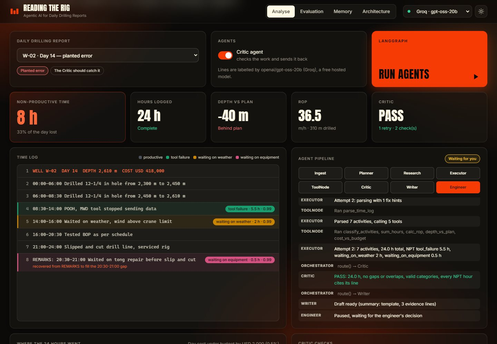
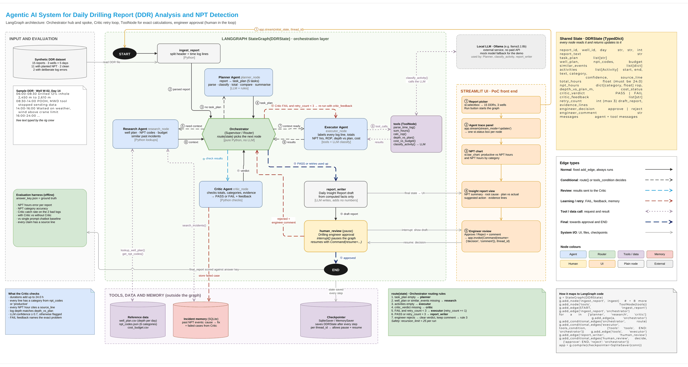

# Reading the Rig

**Agentic AI for Daily Drilling Reports: finding non-productive time with a LangGraph multi-agent system.**
CA-3 · Foundation of Agentic AI · TY AI-ML B · Symbiosis Institute of Technology, Pune
Ranjan Verma and Rahul Narkhede

> Every rig writes a daily report. Lost time hides inside it. A team of AI agents finds it, checks it and
> hands it to an engineer to approve. **Computed** by Python, **Sourced** to a report line, **Approved** by a person.

All data is synthetic. This is a classroom proof of concept, not a certified engineering or safety tool.

**Live:** [rig-sight.onrender.com](https://rig-sight.onrender.com/) (labels lines with a free hosted model, Groq, online; see
[Deployment](#deployment)).
**Code:** [github.com/ranjanvrma/rig-sight](https://github.com/ranjanvrma/rig-sight)

**Submission** ([submission/](submission/)):
[presentation (PPT)](submission/Rig_Sight_CA3_Presentation.pptx) ·
[report (DOCX)](submission/Rig_Sight_CA3_Report.docx) ·
[repository link (DOCX)](submission/Rig_Sight_CA3_Repository_Link.docx). The codebase is this repository.



## Problem

Every drilling rig sends a Daily Drilling Report (DDR) each morning. Most of its hour-by-hour time log is
free text typed by the crew, so **non-productive time (NPT)**, the paid rig hours where the well does not move
forward, hides inside sentences. At about $400,000 a day for a drillship, every lost hour costs roughly $16,000.
Today an engineer reads each report by eye: small losses are never added up, labels differ from person to person,
and lessons from past wells are not reused.

**Question:** how can an engineer get a reliable, evidence-backed account of lost time from every daily report
without reading each one line by line?

## What it does

- Ingests a synthetic DDR (from the dataset or pasted into the app) and parses its time log
- Plans the work, then looks up the well plan, daily budget, NPT categories and similar past incidents
- Labels every activity as productive or one of six NPT categories, with a confidence score
- Computes total hours, NPT by category, rate of penetration (ROP), depth against plan and cost against budget with
  deterministic Python tools
- Validates the result with a Critic. A fixable problem (a gap, an overlap) goes back to the Executor with
  specific hints, at most 3 times. Source-data errors (a bad header, an impossible time) are reported, not repaired
- Drafts a Daily Insight Report that keeps observed data, inferred causes, validation results and suggested
  actions apart, with a source line for every NPT claim
- Pauses for the drilling engineer to approve, or reject with a comment such as `line 7 is planned, not NPT`,
  which the graph acts on before asking again
- Shows all of it live in a web app: the agent pipeline, KPIs, an annotated report, a 24-hour timeline, NPT by
  category, the Critic's checks, memory and evaluation results

## Agents

| Role | Node | Responsibility | Model? |
|---|---|---|---|
| Orchestrator | `orchestrator` + `route()` | Reads the shared `DDRState` and picks the next node | No, plain Python |
| Planner | `planner` | Task list that adapts to the report (REMARKS, drilling lines, depth, cost) | No, rules |
| Research | `research` | Well plan, budget, NPT codes, similar past incidents; missing data becomes a warning | No |
| Executor | `executor` + `tools` | Drives six tools through a LangGraph `ToolNode` in three visits; totals NPT | Classification only |
| Critic | `critic` | Hard checks, specific feedback, decides whether a retry can help, logs failed cases | No |
| Report writer | `report_writer` | Insight report from computed facts | Optional rephrase, off by default |
| Engineer | `human_review` | `interrupt()` pause; approve → END, reject + comment → re-run | Human |

**Routing rules** (`make_route` in [graph.py](graph.py)), first match wins:

1. no `task_plan` → Planner
2. no `well_plan` / `similar_events` → Research
3. `activities` is None → Executor
4. no `critic_verdict` → Critic
5. FAIL, retryable and `retry_count < 3` → Executor with `fix_hints`
6. otherwise → report_writer → human_review
7. engineer rejects → activities and verdict cleared, comment parsed into line overrides → rule 3

`recursion_limit = 50`. Measured: 16 steps for a normal report, 24 with one retry, 32 in the worst case (the
Critic failing every time), which still reaches the engineer.

**What the Critic checks:** a valid header; every time-log line parseable with possible times; at least one entry;
hours add to 24.0; no gaps or overlaps (it names the window); every activity has a valid category; every NPT
claim's text is on its cited line; the NPT total equals the NPT lines; the deepest drilled depth equals the header
depth. Model confidence below 0.7 is flagged for the engineer.

## Architecture



Hub and spoke: every agent hands back to the Orchestrator, and all of them read and write one shared state.
Reference data, the SQLite incident memory and the LangGraph checkpointer sit outside the graph. The web app's
**Architecture** page shows the same graph.

This is the team's design diagram, updated to match the final code (rule-based Planner, `recursion_limit` 50,
the web app as the front end; the model box now reads Groq instead of the original local model). Two details are simplified in the drawing: classification runs
as one `classify_activities` tool over all lines, and the Critic also checks gaps, overlaps, unparseable lines and
the header.

## Technology

Python · LangGraph 1.2 (StateGraph, ToolNode, `interrupt()`, SqliteSaver checkpointer) · LangChain Core 1.6 ·
Groq with `openai/gpt-oss-20b` (hosted, free tier) or a mock classifier · FastAPI + plain HTML/CSS/JavaScript · SQLite · pytest.

"The model reads, Python counts": the language model only labels log lines. Every number is computed by a tool,
so the Critic can check it exactly.

## Repository

```
api.py                 FastAPI server: API + the web pages
web/                   the frontend (index.html, styles.css, app.js, images); no build step
graph.py               DDRState, the eight nodes, route(), graph build, human-in-the-loop
tools.py               Executor tools (ToolNode) and Research lookups; all arithmetic
llm.py                 the only place a model is called: Groq, mock fallback, chatbot baseline
memory.py              SQLite incident memory, failed cases, engineer feedback
evaluate.py            scores the 15 reports: with Critic / without Critic / single-prompt chatbot
data/                  generate_data.py, reports/, answer_key.json, reference files, incidents.sqlite (seed)
results/               metrics_<backend>.json and per_report_<backend>.csv (groq and mock)
tests/                 pytest suite (tools, graph, dataset, web API)
submission/            final PPT, report and repository-link DOCX
runtime/               created on first run: working copy of memory + checkpoints (git-ignored)
```

## Setup

Python 3.11 or newer. Tested on Python 3.14 (local) and 3.11 (clean virtual environment). On Python 3.14,
LangChain prints a harmless warning about Pydantic V1.

```bash
python -m venv .venv
```
```bash
.venv\Scripts\activate          # Windows; on macOS/Linux: source .venv/bin/activate
```
```bash
pip install -r requirements-dev.txt     # runtime deps + pytest (requirements.txt alone is enough to run the app)
```

## Run the app

```bash
python -m uvicorn api:app --port 8000
```

Open http://127.0.0.1:8000 (online: https://rig-sight.onrender.com/). A small FastAPI server (`api.py`) runs the LangGraph agents and streams every agent
step to the page in `web/` (plain HTML, CSS and JavaScript, no build step): report picker and custom reports, live
agent pipeline, KPIs, annotated time log, 24-hour timeline, Critic checks, insight report, engineer approve /
reject, evaluation and memory. The model selector in the top bar switches between Groq and the mock; without a working key Groq is greyed out and the reason is shown.

Pages are real URLs (`/`, `/evaluation`, `/memory`, `/architecture`, plus a 404 page), rendered on the server with
their own title, description, canonical URL, Open Graph tags and structured data; `/robots.txt` and `/sitemap.xml`
are generated. Light and dark themes (follows the system, remembered per browser), keyboard and screen-reader
support (checked with axe-core: no WCAG 2 A/AA violations), and no horizontal scrolling down to 390 px.

| Setting | Default | Meaning |
|---|---|---|
| `RIG_SITE_URL` | `https://rig-sight.onrender.com` | used for canonical URLs, Open Graph and the sitemap |
| `RIG_RUN_LIMIT` / `RIG_RUN_WINDOW` | `30` / `600` | agent runs allowed per visitor per window (seconds); more get HTTP 429 |

The server sends security headers (a Content-Security-Policy, `nosniff`, no framing), limits pasted reports to
20,000 characters and comments to 1,000, and caches static files by content version.

**Suggested demo order** (pick a report, press **Run agents**):

1. **W-01 · Day 10**: clean day, 0 h NPT
2. **W-02 · Day 10**: tool failure, 12 h, MWD fix pulled from memory
3. **W-02 · Day 14**: the first pass adds to 23.5 h; the Critic names the 20:30-21:00 gap; the retry recovers it
   from REMARKS. The model may also label line 7 (slip and cut, planned work) as NPT: reject with
   `line 7 is planned, not NPT`, the graph re-runs to the correct 8.0 h, then approve
4. **Custom report**: paste any report. The sample has an invalid time (`12:00-2:00`), which is marked as a
   source error and left unrepaired

## Tests and evaluation

```bash
python -m pytest
```

57 tests, all passing: tool parsing and validation (malformed lines, impossible and reversed times, missing and
invalid reference files), all 15 reports against the answer key, the Critic catching both planted errors, the
retry, failed cases in memory, the no-Critic ablation, approve and reject-with-override, a missing header, an
empty log, an unknown well, the worst-case retry limit, honest mock reporting, the LLM-summary number guard,
the Groq fallback (one call per report; missing key, failed call), the dataset generator, and the web API (streaming runs, review, pages, SEO files, headers, input limits, rate limit). Tests use the mock and a
temporary database, so they never touch a running model or the committed data.

```bash
python evaluate.py
```

Runs the same 15 reports with the active model through three configurations and writes
`results/metrics_<backend>.json`. Results with Groq `openai/gpt-oss-20b` (23 Oct 2026):

| Run | NPT error / report | Category accuracy | Critic catch | Evidence | Logs = 24 h | Exact NPT |
|---|---|---|---|---|---|---|
| **Graph with Critic** | **0.07 h** | **100%** | **2/2** | **100%** | **15/15** | **14/15** |
| Graph without Critic | 0.77 h | 89.7% | n/a | 100% | 13/15 | 11/15 |
| Single-prompt chatbot | 0.57 h | 94.3% | n/a | 100% | 13/15 | 13/15 |

- Same model, about 8× less error than the chatbot, and every log adds up to 24 h.
- The Critic caught both planted errors before any human saw them. Without it, W-02 D14 shows 23.5 h and
  W-03 D13 shows 24.5 h, and the error rises from 0.07 h to 0.77 h.
- The one remaining miss is W-02 D11: the model counts a 1-hour "flow checked, well static" after a kick as well
  control; the answer key calls it productive. The engineer fixes it with one reject comment.
- Model output varies between runs, even at temperature 0. The chatbot was run three times (mean error 0.63 h,
  0.63 h and 0.43 h; the table shows the mean). On W-02 D14 the model sometimes labels the planned "slipped and cut
  drill line" (3 h) as NPT; rejecting with `line 7 is planned, not NPT` corrects it to 8.0 h.
- Both prompts use the same NPT definition, including "time spent recovering from a failure is NPT". Without
  that sentence the model called the trips out and back in to fix a failure productive (error 1.83 h).
- Mock fallback (`RIG_LLM=mock`): 0.27 h error, 2/2 catches, 14/15 exact. That is optimistic, because the mock's
  keywords and the synthetic reports share a vocabulary.

## Data

`python data/generate_data.py` writes everything; each line is written with its true label, so the answer key does
not depend on the agents.

- 15 reports: 3 wells × days 10-14. 2 clean days (W-01 D10, W-03 D11), 11 with planted NPT covering all six
  categories, 2 planted errors (W-02 D14: a line hidden in REMARKS, so 23.5 h; W-03 D13: a 30-minute overlap,
  so 24.5 h), and one trap: "waited on cement" is planned work
- `well_plan.csv` (planned depth per day), `cost_budget.csv`, `npt_codes.json` (six categories + crew keywords)
- `incidents.sqlite`: 9 past incidents with cause and fix, plus tables the Critic and the engineer write to
- `answer_key.json`: true label per line, NPT hours, depth against plan, ROP

The app never writes to `data/`: it copies the seed memory to `runtime/memory.sqlite` on first use. The
**Memory** page has a reset button.

## Models: Groq and the mock fallback

Get a free key at [console.groq.com/keys](https://console.groq.com/keys) (no card). Locally, put it in a `.env`
file in the project folder (git-ignored):

```
GROQ_API_KEY=gsk_...
```

With `RIG_LLM=auto` (the default) the app and `evaluate.py` use **Groq** when the key works, else the **mock**
keyword classifier built from `npt_codes.json`. The model labels all lines of a report in one request, which keeps
the free tier's per-minute limits out of the way. The top bar, every activity's `labelled_by` field and every report
say which one labelled the lines; if a Groq call fails, those lines fall back to the mock and say `mock`. Settings:

| Variable | Default | Meaning |
|---|---|---|
| `RIG_LLM` | `auto` | `auto` or `mock` |
| `GROQ_API_KEY` | not set | free key from Groq; read on the server only, never sent to the browser |
| `RIG_GROQ_MODEL` | `openai/gpt-oss-20b` | any chat model Groq serves |
| `RIG_GROQ_WAIT` | `6` | seconds to wait out a Groq rate limit before falling back |
| `RIG_LLM_SUMMARY` | off | `1` lets the model rephrase the summary |
| `RIG_MEMORY_DB` | `runtime/memory.sqlite` | working memory database |

The LLM summary is off by default for a reason found during testing: the model kept every number but attached them
to the wrong categories ("weather and equipment, 3.5 hours and 2 hours respectively" when it was 2.0 h and 3.5 h).
A guard rejects summaries with invented numbers, but it cannot catch swapped ones.

## Limitations

- Synthetic data: 15 reports, three wells, one report format, six NPT categories
- The model sometimes labels planned work as NPT with high confidence, so confidence alone is not a safe filter
- The online model needs a free Groq key and an internet connection; its free tier has per-minute and per-day limits
- The parser expects `HH:MM-HH:MM` entries; other formats are reported as errors, not understood
- Overlap trimming guesses which line is wrong; it is disclosed for the rig crew to confirm
- Engineer overrides apply to that run; they are stored but not yet learned from
- Not a certified engineering or safety tool. Every report needs an engineer's approval

## Future scope

Live rig data feeds (WITSML) and many wells at once · learning from engineer corrections · a larger or
fine-tuned classifier evaluated on held-out reports · a morning NPT alert and cross-well trends · MCP connectors to
company systems · support for the IADC standard DDR fields.

## Deployment

The app is deployed on **Render** (free web service) from this repository's `main` branch:
**https://rig-sight.onrender.com/**

| Setting | Value |
|---|---|
| Build command | `pip install -r requirements.txt` |
| Start command | `uvicorn api:app --host 0.0.0.0 --port $PORT` |
| Environment | `PYTHON_VERSION=3.12`, `GROQ_API_KEY=<your key>` (and no `RIG_LLM`, or `RIG_LLM=auto`) |
| Updates | redeploys on every push to `main` |
| Sleeps | after about 15 minutes without visitors; the next visit takes about a minute |

The model runs at Groq, not on the server, so the free plan (512 MB of memory) is enough. Without a key the app
falls back to the mock.
Memory and checkpoints live in `runtime/` on the server: they are temporary (wiped when the app restarts, sleeps or
redeploys) and shared by everyone using it. The Evaluation page shows the committed Groq and mock results
from `results/`.
