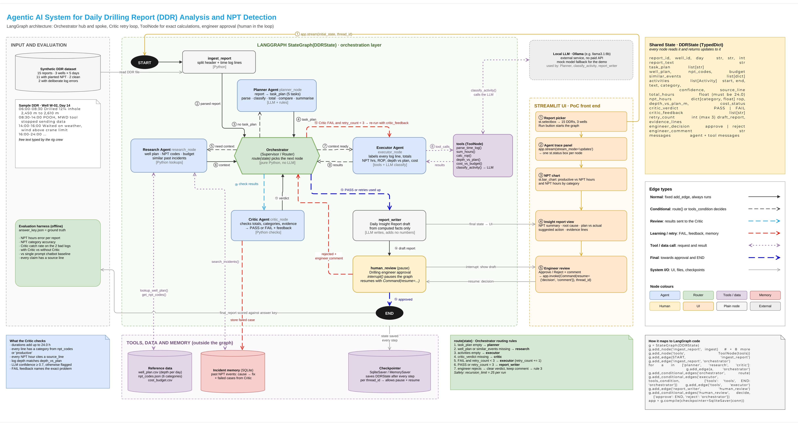

# Reading the Rig

**Agentic AI for Daily Drilling Reports: finding non-productive time with a LangGraph multi-agent system.**
CA-3 · Foundation of Agentic AI · TY AI-ML B · Symbiosis Institute of Technology, Pune
Ranjan Verma and Rahul Narkhede

> Every rig writes a daily report. Lost time hides inside it. A team of AI agents finds it, checks it and
> hands it to an engineer to approve. **Computed** by Python, **Sourced** to a report line, **Approved** by a person.

All data is synthetic. This is a classroom proof of concept, not a certified engineering or safety tool.

**Live demo:** [rig-sight.streamlit.app](https://rig-sight.streamlit.app/) (Streamlit Community Cloud, mock model;
see [Deployment](#deployment))

**Submission** ([submission/](submission/)):
[presentation (PPT)](submission/Rig_Sight_CA3_Presentation.pptx) ·
[report (DOCX)](submission/Rig_Sight_CA3_Report.docx) ·
[repository link (DOCX)](submission/Rig_Sight_CA3_Repository_Link.docx). The codebase is this repository.
[App screenshots](docs/figures/) are in `docs/figures/`.

## Problem

Every drilling rig sends a Daily Drilling Report (DDR) each morning. Most of its hour-by-hour time log is
free text typed by the crew, so **non-productive time (NPT)**, the paid rig hours where the well does not move
forward, hides inside sentences. At about $400,000 a day for a drillship, every lost hour costs roughly $16,000.
Today an engineer reads each report by eye: small losses are never added up, labels differ from person to person,
and lessons from past wells are not reused.

**Question:** how can an engineer get a reliable, evidence-backed account of lost time from every daily report
without reading each one line by line?

## What it does

- Ingests a synthetic DDR (from the dataset or pasted into the app) and parses its time log
- Plans the work, then looks up the well plan, daily budget, NPT categories and similar past incidents
- Labels every activity as productive or one of six NPT categories, with a confidence score
- Computes total hours, NPT by category, rate of penetration (ROP), depth against plan and cost against budget with
  deterministic Python tools
- Validates the result with a Critic. A fixable problem (a gap, an overlap) goes back to the Executor with
  specific hints, at most 3 times. Source-data errors (a bad header, an impossible time) are reported, not repaired
- Drafts a Daily Insight Report that keeps observed data, inferred causes, validation results and suggested
  actions apart, with a source line for every NPT claim
- Pauses for the drilling engineer to approve, or reject with a comment such as `line 7 is planned, not NPT`,
  which the graph acts on before asking again
- Shows all of it live in Streamlit: the agent trace, KPIs, an annotated report, a 24-hour timeline, NPT by
  category, the Critic's checks, memory and evaluation results

## Agents

| Role | Node | Responsibility | Model? |
|---|---|---|---|
| Orchestrator | `orchestrator` + `route()` | Reads the shared `DDRState` and picks the next node | No, plain Python |
| Planner | `planner` | Task list that adapts to the report (REMARKS, drilling lines, depth, cost) | No, rules |
| Research | `research` | Well plan, budget, NPT codes, similar past incidents; missing data becomes a warning | No |
| Executor | `executor` + `tools` | Drives six tools through a LangGraph `ToolNode` in three visits; totals NPT | Classification only |
| Critic | `critic` | Hard checks, specific feedback, decides whether a retry can help, logs failed cases | No |
| Report writer | `report_writer` | Insight report from computed facts | Optional rephrase, off by default |
| Engineer | `human_review` | `interrupt()` pause; approve → END, reject + comment → re-run | Human |

**Routing rules** (`make_route` in [graph.py](graph.py)), first match wins:

1. no `task_plan` → Planner
2. no `well_plan` / `similar_events` → Research
3. `activities` is None → Executor
4. no `critic_verdict` → Critic
5. FAIL, retryable and `retry_count < 3` → Executor with `fix_hints`
6. otherwise → report_writer → human_review
7. engineer rejects → activities and verdict cleared, comment parsed into line overrides → rule 3

`recursion_limit = 50`. Measured: 16 steps for a normal report, 24 with one retry, 32 in the worst case (the
Critic failing every time), which still reaches the engineer.

**What the Critic checks:** a valid header; every time-log line parseable with possible times; at least one entry;
hours add to 24.0; no gaps or overlaps (it names the window); every activity has a valid category; every NPT
claim's text is on its cited line; the NPT total equals the NPT lines; the deepest drilled depth equals the header
depth. Model confidence below 0.7 is flagged for the engineer.

## Architecture



Hub and spoke: every agent hands back to the Orchestrator, and all of them read and write one shared state.
Reference data, the SQLite incident memory and the LangGraph checkpointer sit outside the graph. The app's
**Architecture** tab draws the same graph.

This is the team's design diagram. The final code follows it, with a few differences: the Planner is rule based
(not LLM based), `recursion_limit` is 50 rather than 25 (the worst case needs 32 steps), the model is
`qwen2.5:3b` because `llama3.1:8b` does not fit in 4 GB of GPU memory, classification is one
`classify_activities` tool over all lines, the chart is an Altair timeline plus NPT by category, and the Critic
also checks gaps, overlaps, unparseable lines and the header.

## Technology

Python · LangGraph 1.2 (StateGraph, ToolNode, `interrupt()`, SqliteSaver checkpointer) · LangChain Core 1.6 ·
Gemini `gemini-3.5-flash` (cloud, free tier) or Ollama `qwen2.5:3b` (local) or a mock classifier · Streamlit + Altair · SQLite · pytest.

"The model reads, Python counts": the language model only labels log lines. Every number is computed by a tool,
so the Critic can check it exactly.

## Repository

```
app.py                 Streamlit UI
graph.py               DDRState, the eight nodes, route(), graph build, human-in-the-loop
tools.py               Executor tools (ToolNode) and Research lookups; all arithmetic
llm.py                 the only place a model is called: Gemini, Ollama, mock fallback, chatbot baseline
memory.py              SQLite incident memory, failed cases, engineer feedback
evaluate.py            scores the 15 reports: with Critic / without Critic / single-prompt chatbot
data/                  generate_data.py, reports/, answer_key.json, reference files, incidents.sqlite (seed)
results/               metrics_<backend>.json and per_report_<backend>.csv (gemini, ollama, mock)
tests/                 pytest suite (tools, graph, dataset, app)
docs/figures/          architecture diagram and real app screenshots
docs/build/            scripts that rendered the diagram, captured the screenshots and built the PPT and DOCX
submission/            final PPT and DOCX
runtime/               created on first run: working copy of memory + checkpoints (git-ignored)
```

## Setup

Python 3.11 or newer. Tested on Python 3.14 (local) and 3.11 (clean virtual environment). On Python 3.14,
LangChain prints a harmless warning about Pydantic V1; for Streamlit Community Cloud pick 3.11 or 3.12.

```bash
python -m venv .venv
```
```bash
.venv\Scripts\activate          # Windows; on macOS/Linux: source .venv/bin/activate
```
```bash
pip install -r requirements-dev.txt     # runtime deps + pytest (requirements.txt alone is enough to run the app)
```

## Run the app

Online, nothing to install: **https://rig-sight.streamlit.app/** (runs on the mock classifier).

Locally, with the option of the real model:

```bash
streamlit run app.py
```

Pick a report in the sidebar and press **Run agents**. Suggested demo order:

1. **W-01 · Day 10**: clean day, 0 h NPT
2. **W-02 · Day 10**: tool failure, 12 h, MWD fix pulled from memory
3. **W-02 · Day 14**: the first pass adds to 23.5 h; the Critic names the 20:30-21:00 gap; the retry recovers it
   from REMARKS. With Ollama, the model also labels line 7 (slip and cut, planned work) as NPT: reject with
   `line 7 is planned, not NPT`, the graph re-runs to the correct 8.0 h, then approve
4. **✍ Custom report**: paste any report. The sample has an invalid time (`12:00-2:00`), which is marked as a
   source error and left unrepaired

## Tests and evaluation

```bash
python -m pytest
```

48 tests, all passing: tool parsing and validation (malformed lines, impossible and reversed times, missing and
invalid reference files), all 15 reports against the answer key, the Critic catching both planted errors, the
retry, failed cases in memory, the no-Critic ablation, approve and reject-with-override, a missing header, an
empty log, an unknown well, the worst-case retry limit, honest mock reporting, the LLM-summary number guard,
the Ollama fallback, the dataset generator, and the Streamlit app headless (AppTest). Tests use the mock and a
temporary database, so they never touch a running model or the committed data.

```bash
python evaluate.py
```

Runs the same 15 reports with the active model through three configurations and writes
`results/metrics_<backend>.json`. Results with `qwen2.5:3b` (19 Oct 2026):

| Run | NPT error / report | Category accuracy | Critic catch | Evidence | Logs = 24 h | Exact NPT |
|---|---|---|---|---|---|---|
| **Graph with Critic** | **0.47 h** | **100%** | **2/2** | **100%** | **15/15** | **13/15** |
| Graph without Critic | 0.43 h | 96.6% | n/a | 100% | 13/15 | 13/15 |
| Single-prompt chatbot | 3.83 h | 75.9% | n/a | 95.7% | 1/15 | 4/15 |

- Same model, about 8× less error. The chatbot reported totals between 11 h and 126 h for 24-hour logs.
- The Critic caught both planted errors before any human saw them. Without it, W-02 D14 shows 23.5 h and
  W-03 D13 shows 24.5 h.
- "Without Critic" has a slightly lower error only because two mistakes cancel on W-02 D14 (a missing 0.5 h
  offsets part of a 3 h mislabel). Look at the 24 h column and category accuracy too.
- The two remaining errors are planned work the model labels NPT with high confidence: "slipped and cut drill
  line" (3 h) and "waited on cement" (4 h). Confidence is ≥ 0.9, so the 0.7 floor cannot flag them; the engineer
  fixes each with one reject comment. This is why the human stays in the loop.
- The graph's results were identical on three separate runs (temperature 0). The chatbot's mean error was
  4.43 h, 3.77 h and 3.83 h on three separate runs; the table shows the latest.
- Mock fallback (`RIG_LLM=mock`): 0.27 h error, 2/2 catches, 14/15 exact. That is optimistic, because the mock's
  keywords and the synthetic reports share a vocabulary.

## Data

`python data/generate_data.py` writes everything; each line is written with its true label, so the answer key does
not depend on the agents.

- 15 reports: 3 wells × days 10-14. 2 clean days (W-01 D10, W-03 D11), 11 with planted NPT covering all six
  categories, 2 planted errors (W-02 D14: a line hidden in REMARKS, so 23.5 h; W-03 D13: a 30-minute overlap,
  so 24.5 h), and one trap: "waited on cement" is planned work
- `well_plan.csv` (planned depth per day), `cost_budget.csv`, `npt_codes.json` (six categories + crew keywords)
- `incidents.sqlite`: 9 past incidents with cause and fix, plus tables the Critic and the engineer write to
- `answer_key.json`: true label per line, NPT hours, depth against plan, ROP

The app never writes to `data/`: it copies the seed memory to `runtime/memory.sqlite` on first use. The
**Memory** tab has a reset button.

## Language models: Gemini, Ollama or the mock

The language model only labels log lines; Python does every number. Three options, picked in the sidebar:

| Option | What it needs | Notes |
|---|---|---|
| **Gemini** (`gemini-3.5-flash`, cloud) | A free API key from [Google AI Studio](https://aistudio.google.com/apikey) | No local model. All lines of a report go in one request, answers are cached, busy responses are retried. The report text is sent to Google |
| **Ollama** (`qwen2.5:3b`, local) | `ollama pull qwen2.5:3b` and Ollama running | Free, nothing leaves the computer |
| **Mock** (keyword rules) | Nothing | Always available; the fallback whenever a model is missing or fails |

`RIG_LLM=auto` (the default) picks Gemini if a key is configured, else Ollama if it is running, else the mock. If a
model fails on a line, that line falls back to the mock, and the line, the sidebar and the report all say so.

**Adding your Gemini key locally:** put it in `.streamlit/secrets.toml` (this file is git-ignored):

```toml
GEMINI_API_KEY = "your-key-here"
```

or set the `GEMINI_API_KEY` environment variable. The key goes in a request header, never in a URL, a log or the UI.

| Variable | Default | Meaning |
|---|---|---|
| `RIG_LLM` | `auto` | `auto`, `gemini`, `ollama` or `mock` |
| `GEMINI_API_KEY` | none | Gemini key (or `.streamlit/secrets.toml`) |
| `RIG_GEMINI_MODEL` | `gemini-3.5-flash` | any Gemini model your key can use |
| `RIG_GEMINI_RUN_LIMIT` | `5` | Gemini runs allowed per browser session (the free tier allows about 20 requests a day) |
| `RIG_MODEL` | `qwen2.5:3b` | any Ollama model |
| `OLLAMA_URL` | `http://127.0.0.1:11434` | Ollama server |
| `RIG_LLM_SUMMARY` | off | `1` lets the model rephrase the summary |
| `RIG_MEMORY_DB` | `runtime/memory.sqlite` | working memory database |

The LLM summary is off by default for a reason found during testing: qwen2.5:3b kept every number but attached them
to the wrong categories ("weather and equipment, 3.5 hours and 2 hours respectively" when it was 2.0 h and 3.5 h).
A guard rejects summaries with invented numbers, but it cannot catch swapped ones.

## Limitations

- Synthetic data: 15 reports, three wells, one report format, six NPT categories
- The 3B model labels some planned work as NPT with high confidence, so confidence alone is not a safe filter
- The parser expects `HH:MM-HH:MM` entries; other formats are reported as errors, not understood
- Overlap trimming guesses which line is wrong; it is disclosed for the rig crew to confirm
- Engineer overrides apply to that run; they are stored but not yet learned from
- Not a certified engineering or safety tool. Every report needs an engineer's approval

## Future scope

Live rig data feeds (WITSML) and many wells at once · learning from engineer corrections · a larger or
fine-tuned classifier evaluated on held-out reports · a morning NPT alert and cross-well trends · MCP connectors to
company systems · support for the IADC standard DDR fields.

## Deployment

The app is deployed on Streamlit Community Cloud at **https://rig-sight.streamlit.app/**, from this repository's
`main` branch with `app.py` as the entry point. A push to `main` normally redeploys it; if the live app looks older
than the code here (for example, no **Reset memory** button in the Memory tab), reboot it from the Streamlit Cloud
dashboard (**Manage app → ⋮ → Reboot app**). W-02 Day 14 on the live app gives 8.0 h NPT: the Critic catches the
23.5 h log and the retry recovers the missing half hour.

**Using Gemini on the live app:** in the Streamlit Cloud dashboard open the app's **Settings → Secrets**, add

```toml
GEMINI_API_KEY = "your-key-here"
```

and save; the app restarts with Gemini as its default model. Without the secret, it runs on the mock and says so.

**What is different from running it locally**

| | Live app (Streamlit Cloud) | Local (`streamlit run app.py`) |
|---|---|---|
| Language model | Gemini if the `GEMINI_API_KEY` secret is set, else the mock. There is no Ollama in the cloud, so choosing Ollama shows a warning and falls back to the mock | Gemini with a key, Ollama when it is running, else the mock |
| Quota | Every visitor uses the key's free quota, so each browser session gets 5 Gemini runs (`RIG_GEMINI_RUN_LIMIT`), then the mock; when the daily free quota (about 20 requests) is used up, the app switches to the mock at once and says so. Running the evaluation with Gemini is only offered locally (about 100 requests) | Your own quota |
| What the app says | The sidebar and every report name the model that labelled the lines | Same |
| Evaluation tab | Shows the committed results from `results/` for every model. **Re-run evaluation** there is offered for the mock only when Gemini is active | Re-runs with whichever model is active (Gemini: `python evaluate.py`) |
| Memory and checkpoints | Written to `runtime/` on the server. This is temporary: it is wiped when the app restarts, sleeps or redeploys, and it is shared by everyone using the app at the same time | Kept in `runtime/` until you delete it or press Reset |

Settings (only needed if you deploy your own copy):

1. Fork or push the repository to GitHub
2. On [share.streamlit.io](https://share.streamlit.io) choose **Create app**, pick the repository, branch `main`
   and main file `app.py`
3. Under **Advanced settings** choose Python 3.11 or 3.12 (3.14 works locally but prints a LangChain warning), and
   paste `GEMINI_API_KEY = "..."` into **Secrets** if you want Gemini
4. `requirements.txt` and `.streamlit/config.toml` (dark theme, headless) are picked up automatically
